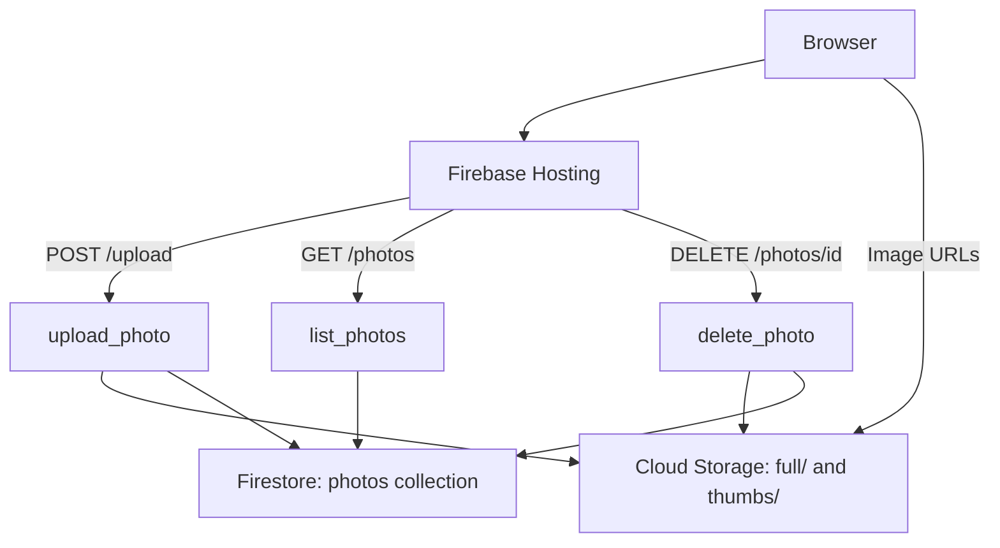

# Photo Gallery GCP

A serverless photo gallery migrated from AWS to Google Cloud. The GCP implementation keeps three separate Python HTTP functions for uploading, listing, and deleting photos, with Firebase Hosting serving the website.


## Features

- Upload JPEG, PNG, and WebP images up to 5 MiB and 20 megapixels.
- Generate JPEG thumbnails with a maximum dimension of 400 pixels.
- Browse photos, filter by user and topic, and open full-photo details.
- Switch between light/dark themes and grid/list layouts.
- Delete an original, its thumbnail, and the associated metadata.
- Handle invalid input, partial uploads, and retryable deletion failures.

## Architecture



| AWS source | GCP implementation |
| --- | --- |
| Lambda | Three second-generation Cloud Run functions |
| S3 | Cloud Storage |
| DynamoDB | Firestore Native mode |
| API Gateway routing | Firebase Hosting rewrites |
| Lambda execution role | Runtime service account and IAM |

The functions use Python 3.13, 512 MiB memory, a 60-second timeout, zero minimum instances, and a maximum of two instances each in `us-central1`.

## Repository layout

```text
AWS/                         Historical AWS source for reference
GCP/
  public/                    HTML, CSS, and JavaScript website
  functions/                 Python handlers and application logic
  tests/                     20 HTTP contract and failure-handling tests
  scripts/                   Setup and deployment helpers
  Photo gallery Output/      25 categorized demonstration screenshots
  firebase.json              Functions, Hosting, rules, and emulator configuration
  firestore.rules            Denies direct browser access to Firestore
  Cloud_Computing_Project_Summary_Report.pdf
```

## Run the local checks

Install Python 3.13 and Node.js 22 or later, then:

```bash
git clone https://github.com/Harshavardhan-13/photo-gallery-gcp.git
cd photo-gallery-gcp/GCP
npm ci
python3.13 -m venv functions/venv
functions/venv/bin/python -m pip install -r functions/requirements.txt
npm test
node --check public/app.js
```

The tests use mocked Google Cloud clients and need no cloud credentials. They cover uploads, supported formats, validation, cleanup after failures, list responses, and deletion retries. They do not test a live deployment.

## Deploy your own copy

Follow the [GCP setup and deployment guide](GCP/README.md). Create your own project and choose it explicitly; the repository does not default to the original deployment.

This repository is an archive and a reproducible source project. The original website address in the historical report is evidence of that deployment, not a promise that a live demo is still available.

## Project report and evidence

Read the [58-page project report](GCP/Cloud_Computing_Project_Summary_Report.pdf) for the migration decisions, commands, warnings, build-permission failure and fix, complete 844-line terminal record, and screenshot evidence. The report also embeds all five original terminal pastes. Historical account/project identifiers and local paths are retained for traceability; they are not login credentials.

The [screenshot guide](GCP/Photo%20gallery%20Output/START_HERE.txt) explains the before/after-deletion sequence. The repository includes the 25 app and cloud-console proof captures. Duplicate originals, chat-instruction captures, downloaded dependencies, and standalone raw transcript exports stay local.

Screenshots demonstrate the core JPEG demo flow. Live PNG/WebP uploads, exact cloud thumbnail dimensions, a complete browser Network/Console inspection, and full mobile testing are not established by those captures. Local tests cover additional backend behavior. The small preview CSS adjustment was checked locally and is not shown as a verified hosted change.

## Access and cost

This is a public college demonstration without login. Anyone with access can view, upload, and delete photos. The setup helper grants public read access to the dedicated image bucket. Firestore is accessed through the backend's IAM identity; browser access is denied by the rules.

Deployment requires billing. Free allowances are not a guarantee of zero cost; retained storage, artifacts, builds, and traffic can be billed. Configure billing alerts and review usage. Do not upload private images or use this anonymous access model for a production gallery.

The saved npm audit reported 14 moderate findings in Firebase CLI dependencies. A compatible `npm audit fix` did not resolve them; the suggested forced downgrade was not applied. They are documented in the report. No clean dependency-security audit is claimed.
